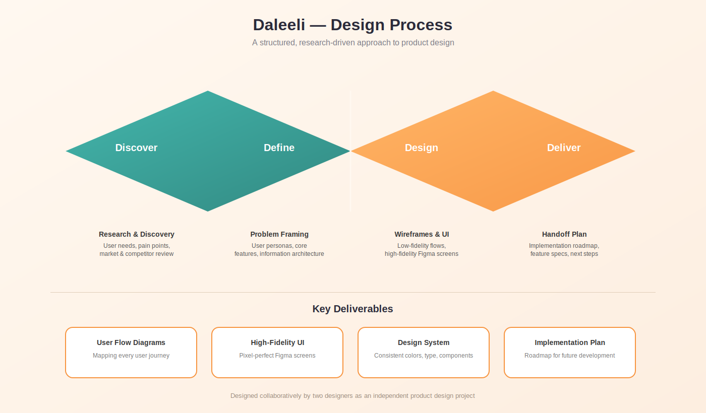
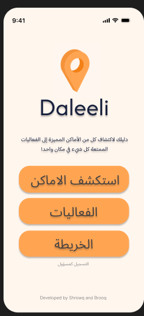
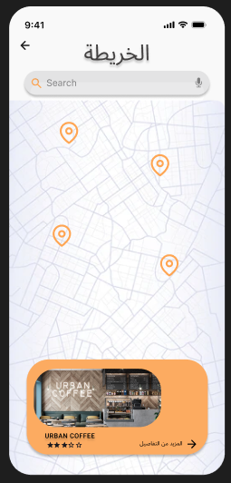
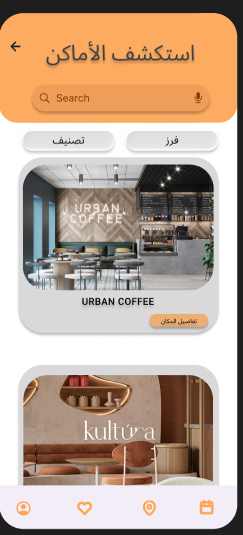
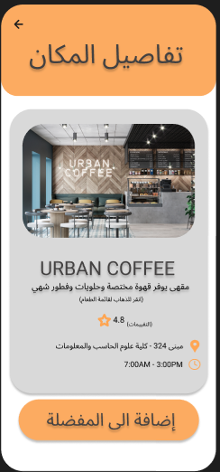
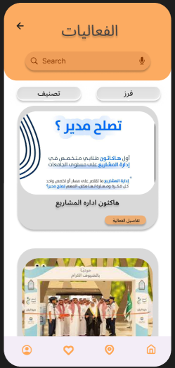
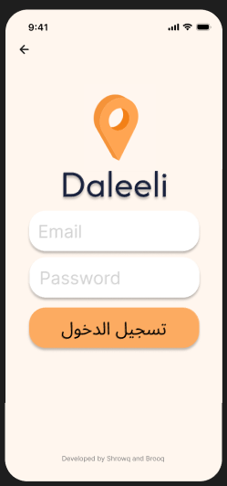
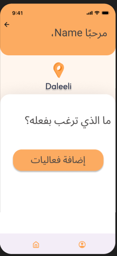
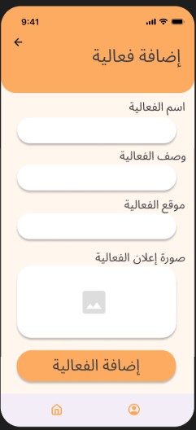

# Daleeli — Campus Navigation App
### UX/UI Case Study

Daleeli is a UX/UI design project for a campus navigation app that helps university students discover coffee shops and events happening around their university — all in one simple, visual platform.

> **Project type:** Independent product design case study (research → persona → design process → high-fidelity UI in Figma)
> **Status:** Design complete. Development is the next planned phase.
> **Figma prototype:** [View the interactive prototype](https://www.figma.com/proto/Uz6eSeGAt0BCjhf3zxq85q/Daleeli?node-id=50-226&t=q41M1JbAWyyDBvpm-1)

---

## 📌 The Problem

University students often miss out on events happening on campus, and have no single reliable place to discover nearby coffee shops or spots worth visiting. Information is scattered across maps, social media, and word of mouth — with no unified source to explore what's happening around them.

## 🎯 The Solution

Daleeli brings places and events together in one simple, visual map-based platform — letting students explore, filter, and stay updated in a few taps, instead of piecing together information from multiple disconnected sources.

---

## 👤 User Persona

We grounded the design in a real user need before building any screens.

**Sara** — a 20-year-old university student, always on the go between classes and hangouts.

**Goals**
- Find good places to study, eat, or relax nearby
- Discover events happening around campus
- Save time instead of asking around or checking multiple apps

**Frustrations**
- Information about local spots is scattered
- Hard to know which places are currently active or recommended
- Events get missed because there's no single reliable source

**Needs from the app**
- A single, simple platform to browse and filter
- Real-time updates on new or upcoming events
- Quick filtering by category (coffee shops, events)

---

## 🔄 Design Process

We followed a structured, research-driven process based on the **Double Diamond** model.

| Phase | What we did |
|---|---|
| **Discover** | User needs, pain points, and a review of similar map/discovery apps |
| **Define** | Built the user persona, defined core features, and mapped the information architecture |
| **Design** | Low-fidelity user flows, then high-fidelity screens in Figma |
| **Deliver** | Implementation roadmap and feature specs for the next development phase |

### Key Deliverables
- **User Flow Diagrams** — mapping every user journey
- **High-Fidelity UI** — pixel-perfect Figma screens
- **Design System** — consistent colors, typography, and components
- **Implementation Plan** — roadmap for future development

---

## 📱 The Screens

The app has two experiences:

**Student-facing (public browsing)**

| Home | Map | Explore Places |
|---|---|---|
|  |  |  |

| Place Details | Events | Login |
|---|---|---|
|  |  |  |

**Admin-facing (for authorized event managers)**

| Manager Prompt | Add Activity |
|---|---|
|  |  |

> *Replace the file names above with your actual screenshot files, or paste the screenshot images directly into this README on GitHub's web editor.*

---

## 🛠 Tools Used
- Figma — UI design & prototyping
- FigJam — persona & design process mapping

---

## 🚀 Next Steps

This case study covers the research, persona, and design phases. The next phase is turning these designs into a working application — starting with the interactive map, place/event data structure, and the admin permission system for adding activities.

---

## 👥 Team

Designed collaboratively by two designers Shrowq alharbi and Broog as an independent product design project.

## 📄 License

See [LICENSE](./LICENSE.md) for usage terms.
